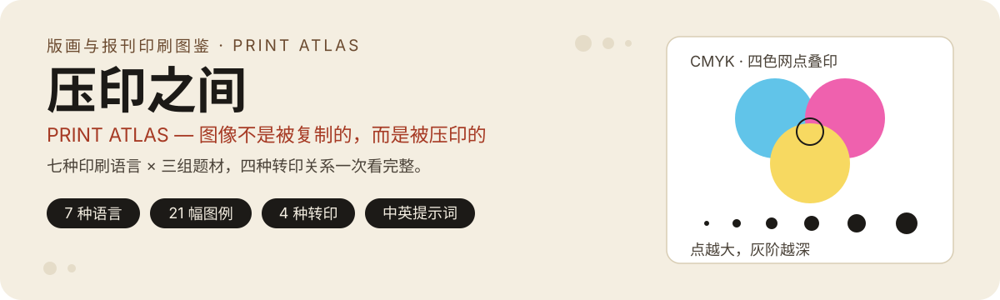
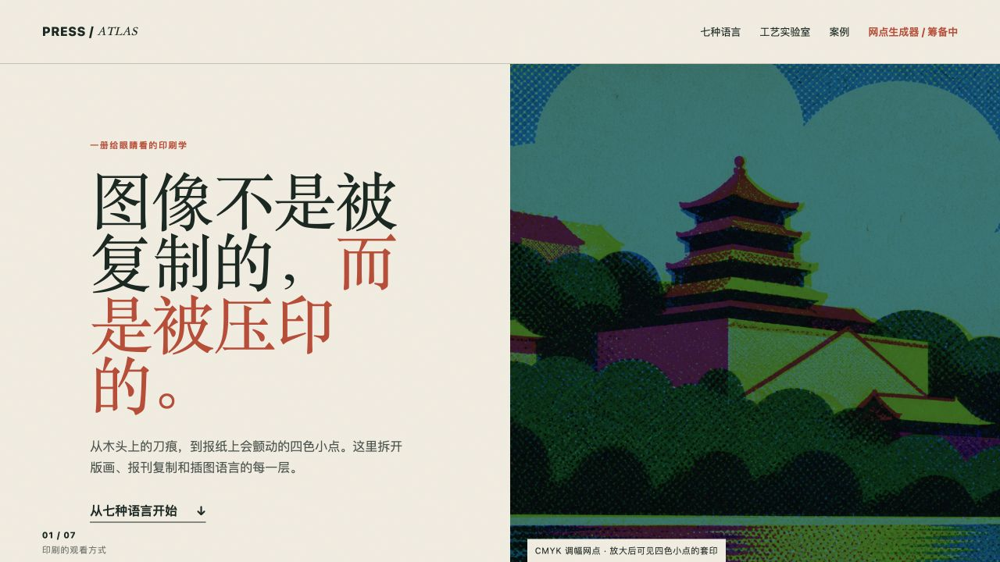

<p align="right">
  <a href="./README.md">简体中文</a> · <strong>English</strong>
</p>

<p align="center">
  
</p>

<p align="center">
  <a href="https://print-atlas.xiaosang.cc/"><strong>🌐 Live Demo (Primary)</strong></a> · 
  <a href="https://holynova.github.io/print-atlas/"><strong>🚀 Mirror (GitHub Pages)</strong></a> · 
  <a href="https://github.com/holynova/print-atlas"><strong>📦 GitHub Source</strong></a> · 
  <a href="https://xiaosang.cc/"><strong>✨ Portfolio</strong></a>
</p>

---

## Proof of Work

<p align="center">
  
</p>

---

## What It Is

An interactive exploration of how imagery transfers onto paper. Deconstructs the physical principles of four traditional printmaking techniques (relief, intaglio, planographic, and serigraphy) and extends into modern halftone dot angles (15°, 45°, 75°) and the microscopic rosette patterns created by CMYK 4-color process printing.

---

## Why It Matters (Key Features)

- **4 Traditional Printmaking Mechanics**: Step-by-step illustrated explanations of relief, intaglio, planography (lithography), and serigraphy (screen printing).
- **Seven Print Languages, Three Subjects Each**: woodcut, pen hatching, halftone, CMYK overprint, lithograph, screen print, and etching — each with a figure, a landscape, and a sheep, plus copyable Chinese/English image prompts.
- **Halftone & Rosette Diagrams**: dot size simulates tone; cyan 15°, magenta 75°, yellow 0°, and black 45° screens overlap into a rosette.
- **Texture Identification Table**: guess the process from the texture — regular dots mean halftone, four-color dots mean CMYK overprint, parallel hatching means pen or woodcut, random grain means aquatint.

---

## Inventory & Scope

A field guide to 7 print languages (21 specimens + 14 bilingual prompts), 4 transfer processes, halftone & rosette diagrams, and a texture table.

---

## Quick Start

### 1. Live Demos
Experience it directly in your browser without any setup:
- 🌐 **Primary Demo**: [https://print-atlas.xiaosang.cc/](https://print-atlas.xiaosang.cc/)
- 🚀 **Alternative Mirror (GitHub Pages)**: [https://holynova.github.io/print-atlas/](https://holynova.github.io/print-atlas/)

### 2. Local Development
Clone the repository and launch locally:

```bash
git clone https://github.com/holynova/print-atlas.git
cd print-atlas
open index.html # Pure static HTML5, open directly in browser
```

---

## License & Author

- **Author**: [holynova (Xiaosang)](https://xiaosang.cc/)
- **License**: [MIT License](./LICENSE)
- **Featured Collection**: Curated as part of [Where Craft Lives (xiaosang.cc)](https://xiaosang.cc/).
